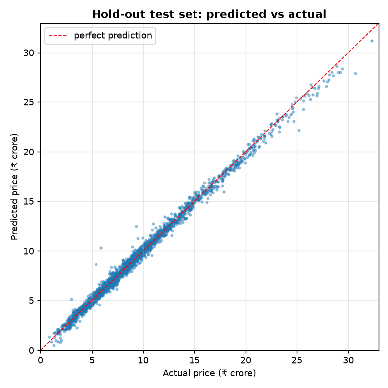
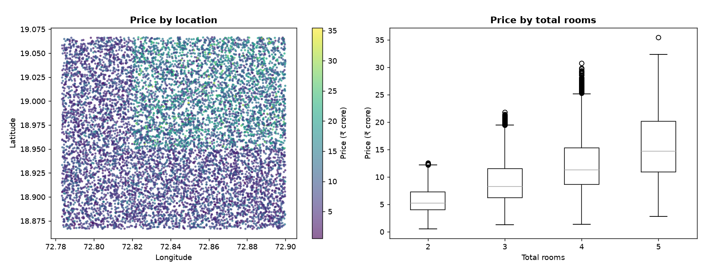
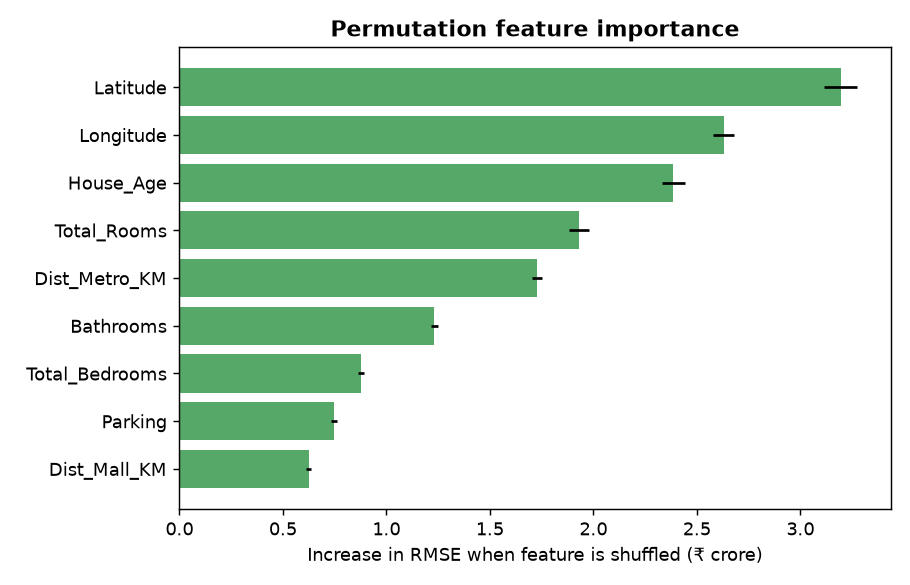

# MHPI — Mumbai House Price Intelligence

Regression model that estimates **Mumbai property prices (₹ crore)** from location, size, age and distance to amenities, built as an end-to-end, reproducible scikit-learn pipeline.


## Problem
Buyers, brokers and lenders need a fast, consistent first estimate of what a flat is worth. Can listing attributes alone predict price accurately?

## Dataset
`data/raw/mumbai_house_raw_data.csv` — **10,000 listings**, 9 numeric features, no missing values or duplicates.

| Feature | Description |
|---|---|
| `Longitude`, `Latitude` | location (72.78–72.90 E, 18.87–19.07 N) |
| `House_Age` | years (0–50) |
| `Total_Rooms`, `Total_Bedrooms`, `Bathrooms` | 2–5 rooms, 1–3 bedrooms, 1–4 bathrooms |
| `Parking` | 0–2 spots |
| `Dist_Mall_KM`, `Dist_Metro_KM` | distance to nearest mall / metro station |
| **`Price_Crore`** (target) | ₹0.54 – 35.5 crore, median ₹8.5 crore |

> **Honest note:** the origin of this dataset is not documented. Listings are spread uniformly over a lat/long rectangle and prices are high relative to the real Mumbai market, so it is very likely **synthetic**. The near-perfect scores below reflect how cleanly the data was generated; expect lower accuracy on real listings.

## Approach
1. **Split** (`src/split_data.py`) — 80/20 stratified shuffle split on price quintiles.
2. **Pipeline** — median imputation → `StandardScaler` → model, wrapped in one scikit-learn `Pipeline`.
3. **Model comparison** (`src/train_evaluate.py`) — mean baseline, Linear Regression, Decision Tree, Random Forest, Gradient Boosting; best model chosen on **5-fold CV RMSE (train only)**, then evaluated once on the hold-out set.
4. **Explainability** (`src/make_charts.py`) — permutation feature importance.

## Results (hold-out test set, 2,000 listings)
Evaluated with regression metrics — **R², MAE, RMSE** (₹ crore).

| Model | CV RMSE | Test R² | Test MAE | Test RMSE | Test MAPE |
|---|---:|---:|---:|---:|---:|
| Baseline (mean) | 5.22 | 0.00 | 4.07 | 5.31 | 62% |
| Linear Regression | 2.51 | 0.78 | 1.91 | 2.49 | 26% |
| Decision Tree | 0.91 | 0.973 | 0.61 | 0.87 | 8.0% |
| Random Forest | 0.59 | 0.989 | 0.40 | 0.55 | 5.5% |
| **Gradient Boosting (selected)** | **0.46** | **0.993** | **0.31** | **0.44** | **4.4%** |

The selected model is off by **≈ ₹31 lakh on average** (MAE 0.31 crore) on properties with a median price of ₹8.5 crore. The large gap between Linear Regression and the tree ensembles shows that price depends on location in a non-linear way.



## Insights


- **Location is the strongest signal** — latitude and longitude are the top two features; the north-central part of the area carries a clear price premium (median ₹10.2 Cr in the northern quarter vs ₹6.7 Cr in the southern quarter).
- **Size:** median price rises steadily with rooms — ₹5.3 Cr (2 rooms) → ₹8.3 Cr (3) → ₹11.3 Cr (4) → ₹14.7 Cr (5).
- **Metro access matters more than mall access:** homes within 1 km of a metro have a median of ₹10.0 Cr vs ₹4.5 Cr beyond 6 km.
- **Age discounts value:** median ₹10.0 Cr for homes ≤ 5 years old vs ₹5.0 Cr for 30+ years.



## Repository structure
```
MHPI-Mumbai-House-Price-Intelligence-/
├── data/raw/mumbai_house_raw_data.csv
├── src/
│   ├── config.py           # paths & constants
│   ├── split_data.py       # stratified split
│   ├── train_evaluate.py   # model comparison + save best
│   ├── predict.py          # batch predictions
│   └── make_charts.py      # README charts
├── images/  outputs/
├── requirements.txt
└── README.md
```

## How to run
```bash
pip install -r requirements.txt
python src/split_data.py
python src/train_evaluate.py   # prints the comparison table, saves models/price_model.joblib
python src/predict.py          # -> outputs/predictions.csv (or: python src/predict.py in.csv out.csv)
python src/make_charts.py      # -> images/
```

## Tech stack
Python · pandas · NumPy · scikit-learn · Matplotlib · joblib

## Next steps
- Re-train on real listings (e.g. scraped or Kaggle Mumbai housing data with locality names and carpet area).
- Engineer features such as price per sq ft, locality clusters (k-means on lat/long) and distance to CBDs (BKC, Nariman Point).
- Tune with `RandomizedSearchCV`; add SHAP explanations for individual predictions.
- Serve via a Streamlit app with a map-based input.

## Author
**Pushpak Kumar Sahu** — [LinkedIn](https://linkedin.com/in/pushpak-kumar-sahu-2314593a6/) · p7050552704@gmail.com
